<p align="center">
  
</p>

<p align="center">
  <b>Periksa kualitas file Excel &amp; CSV secara otomatis</b> — tanpa memeriksa baris satu per satu.<br>
  Atur aturan validasinya, lalu unduh laporan berisi <i>baris bermasalah, alasan, dan saran perbaikannya</i>.
</p>

<p align="center">
  <a href="#-mulai-cepat"></a>
  <a href="#-mulai-cepat"></a>
  <a href="#-pengujian"></a>
  <a href="#-14-tipe-aturan"></a>
  <a href="LICENSE"></a>
  <a href="https://github.com/features/actions"></a>
</p>

<p align="center">
  <a href="#-tangkapan-layar"><b>Tangkapan Layar</b></a> ·
  <a href="#-laporan-excel"><b>Laporan Excel</b></a> ·
  <a href="#-mulai-cepat"><b>Mulai Cepat</b></a> ·
  <a href="#-14-tipe-aturan"><b>Tipe Aturan</b></a> ·
  <a href="#-pemakaian-sebagai-library"><b>API</b></a> ·
  <a href="#-pengujian"><b>Pengujian</b></a>
</p>

<br>

<p align="center">
  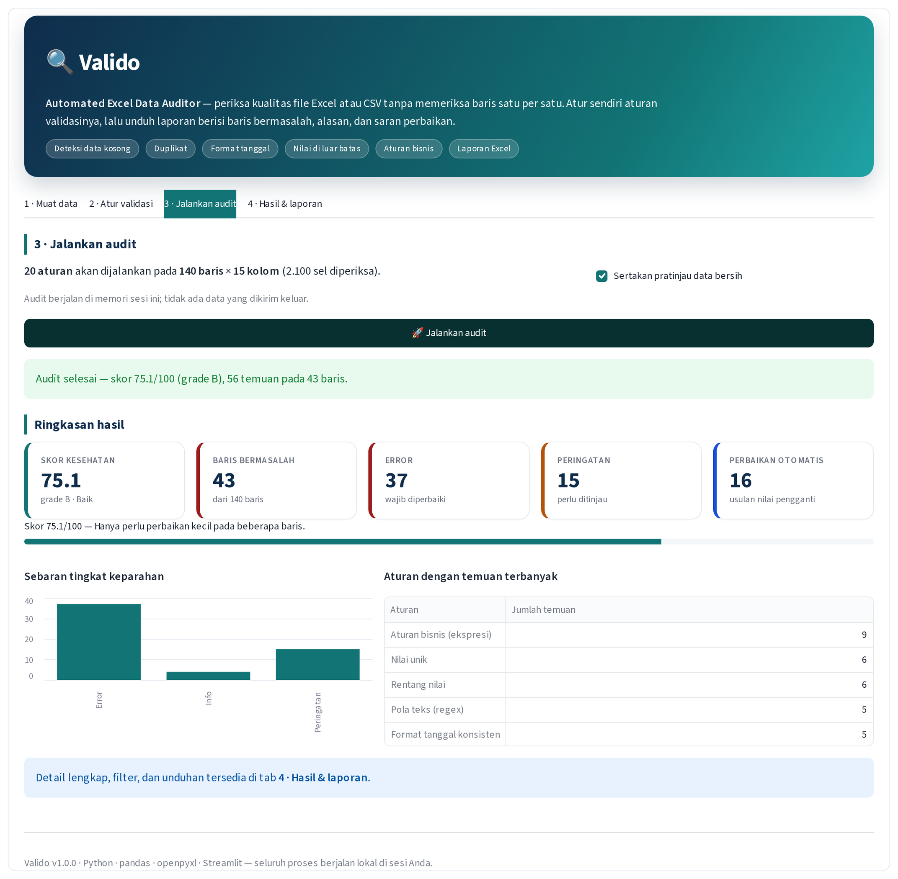
  <br>
  <sub><i>Audit 140 baris × 15 kolom dengan 20 aturan selesai dalam hitungan detik — lengkap dengan skor kesehatan data, sebaran tingkat keparahan, dan aturan dengan temuan terbanyak.</i></sub>
</p>

---

## 📋 Daftar Isi

- [Masalah yang diselesaikan](#-masalah-yang-diselesaikan)
- [Fitur unggulan](#-fitur-unggulan)
- [Cara kerja](#-cara-kerja)
- [Tangkapan layar](#-tangkapan-layar)
- [Laporan Excel](#-laporan-excel)
- [Mulai cepat](#-mulai-cepat)
- [Menggunakan CLI](#-menggunakan-cli)
- [14 tipe aturan](#-14-tipe-aturan)
- [Contoh konfigurasi](#-contoh-konfigurasi)
- [Skor kesehatan data](#-skor-kesehatan-data)
- [Pemakaian sebagai library](#-pemakaian-sebagai-library)
- [Struktur proyek](#-struktur-proyek)
- [Pengujian](#-pengujian)
- [Desain & batasan](#-desain--batasan)
- [FAQ](#-faq)
- [Roadmap](#-roadmap)
- [Lisensi](#-lisensi)

---

## 🎯 Masalah yang diselesaikan

File operasional — ekspor sistem, rekap penjualan, data pelanggan — hampir selalu membawa masalah kecil yang mahal: sel kosong, ID ganda, tanggal dengan lima format berbeda, atau angka yang "tercemar" teks. Menemukannya secara manual lambat, tidak konsisten, dan hasilnya tidak bisa diaudit ulang.

Valido mengubahnya menjadi proses yang **cepat, konsisten, dan terdokumentasi**:

| | Cara manual | Dengan Valido |
| :--- | :--- | :--- |
| **Kecepatan** | Menyisir baris satu per satu dengan mata | Seluruh sel diperiksa dalam hitungan detik |
| **Konsistensi** | Aturan berubah-ubah tiap orang | Aturan disimpan sebagai konfigurasi YAML yang dapat dipakai ulang |
| **Bukti** | Temuan tidak tercatat | Setiap temuan punya **alasan** + **saran perbaikan** |
| **Tindak lanjut** | Diperbaiki tanpa jejak | Laporan Excel memuat statistik, profil kolom, dan pratinjau data bersih |
| **Otomasi** | Tidak bisa masuk pipeline | CLI dengan exit code, siap dipakai di CI/CD |

---

## ✨ Fitur unggulan

<table>
<tr>
<td width="50%" valign="top">

**🔍 Pemeriksaan menyeluruh**
- 📌 **Data kosong** — termasuk `""`, spasi, `N/A`, `null`, `-`
- 🔑 **Duplikat** — nilai yang harus unik & baris ganda
- 📅 **Format tanggal tidak konsisten** — deteksi format dominan + tanggal mustahil (`31/02/2025`)
- 📏 **Nilai di luar batas** — rentang, daftar baku, regex, tipe data, panjang teks, outlier
- 🧠 **Aturan bisnis** — ekspresi antar-kolom, mis. `Total == Qty * Harga Satuan`

</td>
<td width="50%" valign="top">

**📊 Output siap pakai**
- 📄 **Laporan Excel 6 sheet** — ringkasan, detail temuan, statistik, profil, data bersih, konfigurasi
- ⚡ **Skor Kesehatan Data 0–100 + grade A–E** agar kualitas bisa dibandingkan antar waktu
- 🧼 **Perbaikan otomatis yang aman** — trim spasi, normalisasi tanggal, koreksi ke nilai baku
- 🤖 **Saran aturan otomatis** berdasarkan nama kolom & profil isi data
- 🖥️ **Dua antarmuka** — Streamlit untuk pengguna bisnis, CLI untuk otomasi

</td>
</tr>
</table>

---

## 🔄 Cara kerja

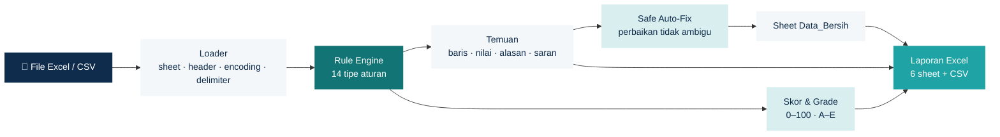

Empat langkah di aplikasi:

| Langkah | Yang terjadi |
| :---: | :--- |
| **1 · Muat data** | Unggah `.xlsx/.xlsm/.csv`, pilih sheet & baris header. Valido menormalkan nama kolom dan melaporkan kondisi file. |
| **2 · Atur validasi** | Buat aturan otomatis dari profil data atau tambahkan manual lewat form. Impor/ekspor YAML kapan pun. |
| **3 · Jalankan audit** | Seluruh aturan dijalankan; hasilnya skor, grade, dan sebaran temuan. |
| **4 · Hasil & laporan** | Filter temuan, telusuri satu baris beserta isi aslinya, lalu unduh laporan. |

---

## 📸 Tangkapan layar

> Semua gambar di bawah diambil otomatis dari aplikasi yang berjalan (`scripts/capture_screenshots.py`), bukan mockup.

### 1 · Muat file Excel / CSV

<p align="center">
  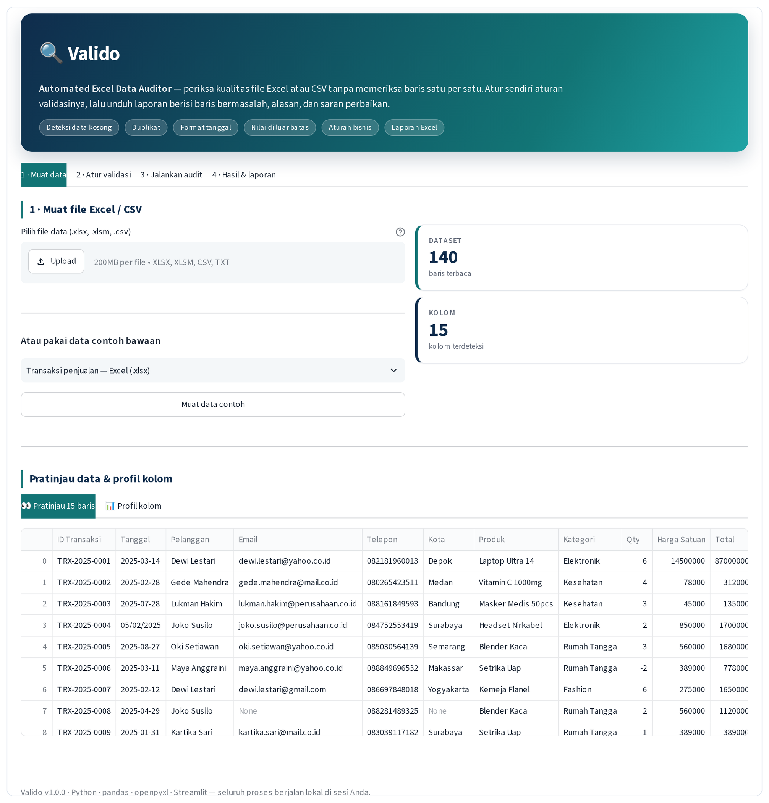
</p>

Unggah file atau pakai data contoh bawaan. Valido langsung menampilkan ukuran dataset, catatan pembacaan file, pratinjau 15 baris, serta **profil kolom** (tipe terdeteksi, persentase kosong, nilai unik, min/maks, contoh nilai) — berguna untuk memutuskan aturan apa yang perlu dibuat.

<br>

### 2 · Susun aturan validasi

<table>
<tr>
<td width="58%">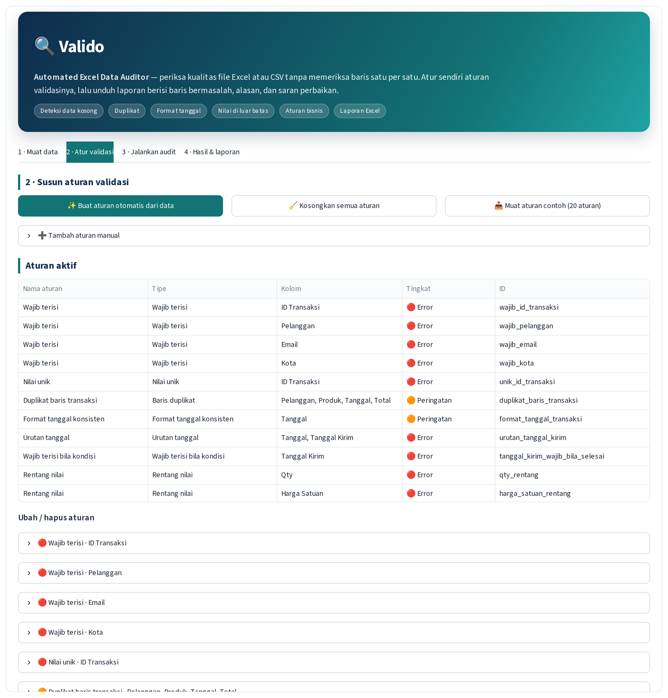</td>
<td width="42%">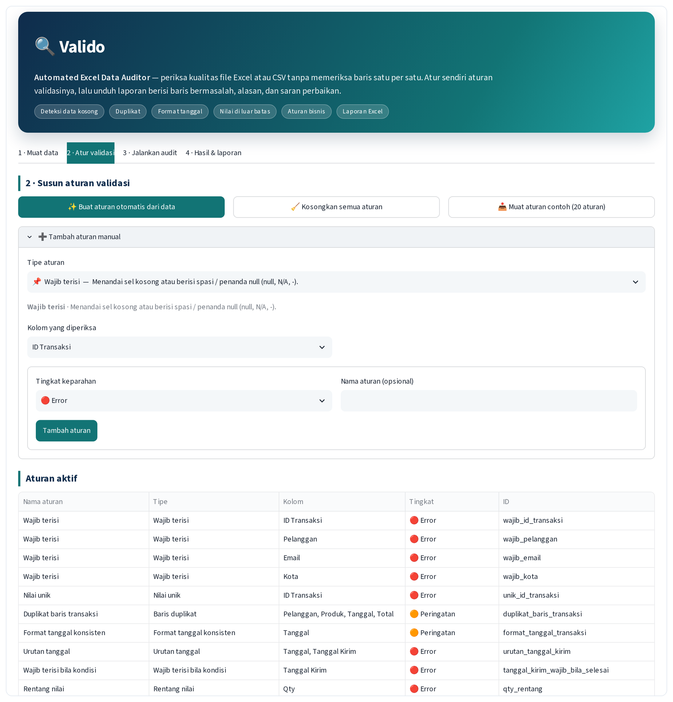</td>
</tr>
<tr>
<td><sub><b>Aturan aktif</b> — ringkasan seluruh aturan beserta kolom, tingkat keparahan, dan ID. Satu klik untuk <i>membuat aturan otomatis dari data</i>.</sub></td>
<td><sub><b>Tambah aturan manual</b> — pilih tipe aturan, kolom, parameter, dan tingkat keparahan lewat form; validasi langsung mencegah konfigurasi keliru.</sub></td>
</tr>
</table>

Konfigurasi juga bisa diimpor dari YAML/JSON, diekspor kembali, atau diedit langsung di editor YAML di dalam aplikasi.

<br>

### 3 · Jalankan audit

<table>
<tr>
<td width="50%">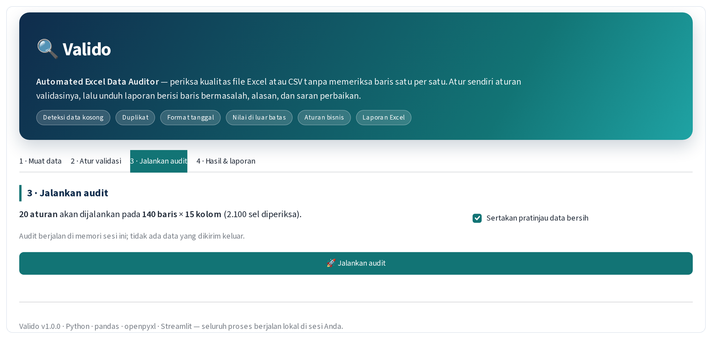</td>
<td width="50%"></td>
</tr>
<tr>
<td><sub><b>Sebelum audit</b> — Valido menampilkan berapa aturan yang akan dijalankan dan berapa sel yang akan diperiksa (2.100 sel pada contoh ini).</sub></td>
<td><sub><b>Setelah audit</b> — skor kesehatan, baris bermasalah, jumlah error/peringatan, dan usulan perbaikan otomatis dalam kartu ringkas.</sub></td>
</tr>
</table>

<br>

### 4 · Hasil, penelusuran, dan unduhan

<p align="center">
  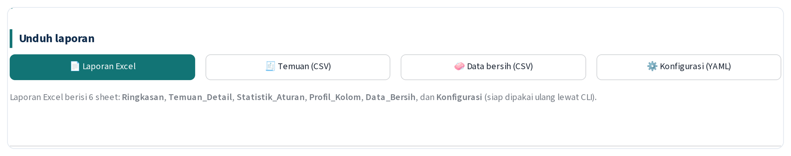
</p>

Tabel temuan dapat difilter per **tingkat**, **aturan**, **kolom**, atau kata kunci. Empat tombol unduhan menyiapkan laporan Excel, CSV temuan, CSV data bersih, dan YAML konfigurasi — semuanya dari satu kali audit.

<p align="center">
  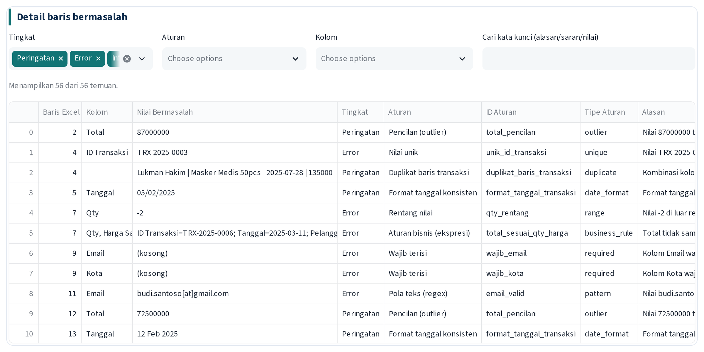
  <br>
  <sub><b>Tabel temuan</b> — 56 temuan pada contoh ini, masing-masing menampilkan baris Excel, kolom, nilai bermasalah, tingkat, aturan, alasan, saran, dan usulan perbaikan otomatis.</sub>
</p>

<br>

### 5 · Telusuri satu baris & periksa data bersih

<table>
<tr>
<td width="50%">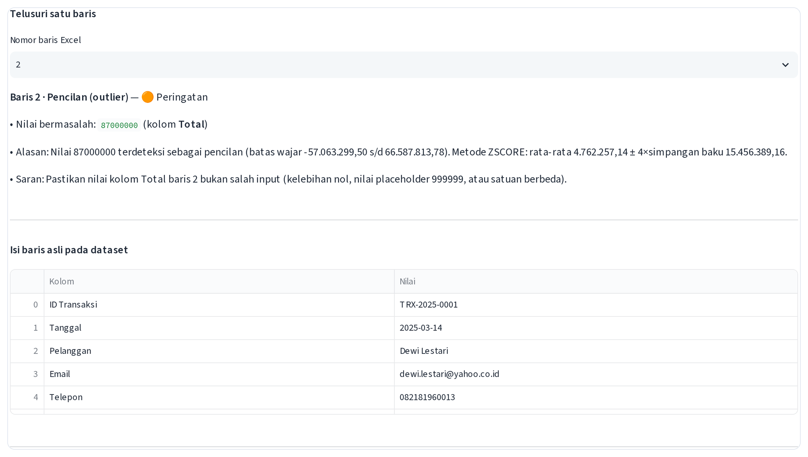<br>
<sub><b>Telusuri satu baris</b> — pilih nomor baris Excel, lihat semua temuan pada baris itu beserta nilai aslinya, alasan, saran, dan usulan perbaikan.</sub></td>
<td width="50%">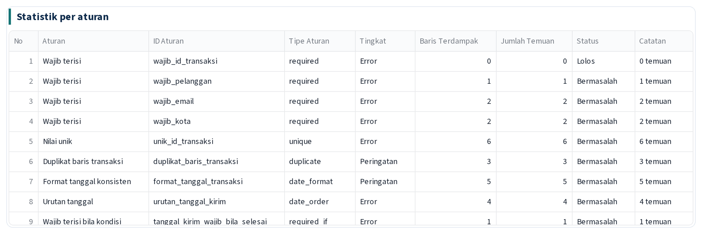<br>
<sub><b>Statistik per aturan</b> — aturan mana yang paling banyak menemukan masalah, berapa baris terdampak, dan status eksekusinya.</sub></td>
</tr>
</table>

<p align="center">
  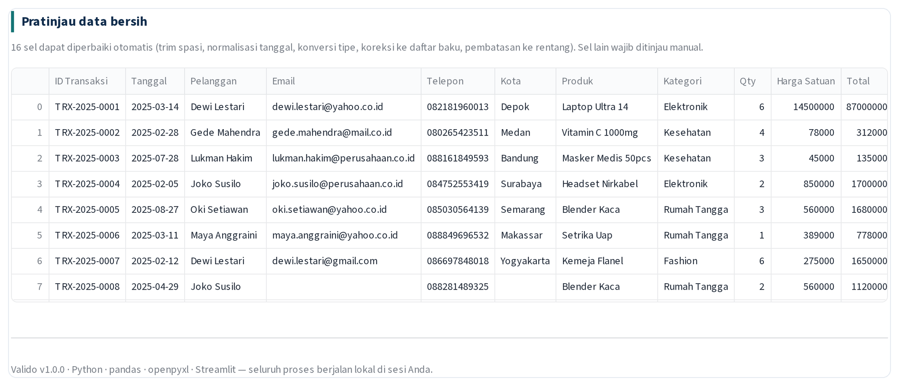
  <br>
  <sub><b>Pratinjau data bersih</b> — perbaikan aman (trim spasi, normalisasi tanggal, koreksi nilai baku, pembatasan ke rentang) sudah diterapkan, siap ditinjau sebelum dipakai.</sub>
</p>

---

## 📄 Laporan Excel

Satu kali audit menghasilkan workbook dengan **6 sheet** yang saling melengkapi:

<table>
<tr>
<td width="50%">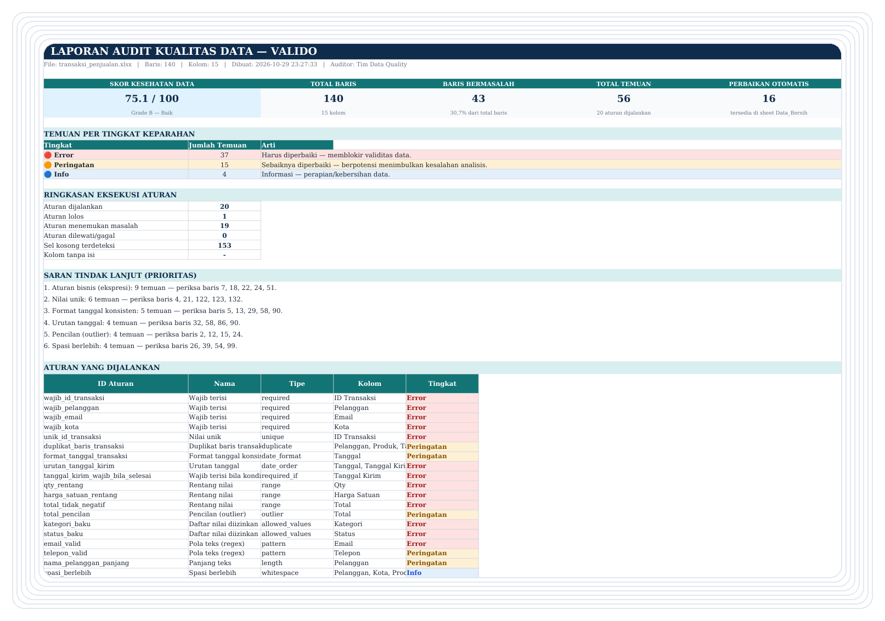<br>
<sub><b>1 · Ringkasan</b> — skor &amp; grade, kartu KPI, temuan per tingkat, ringkasan eksekusi, saran prioritas, daftar aturan, dan catatan pembacaan file.</sub></td>
<td width="50%">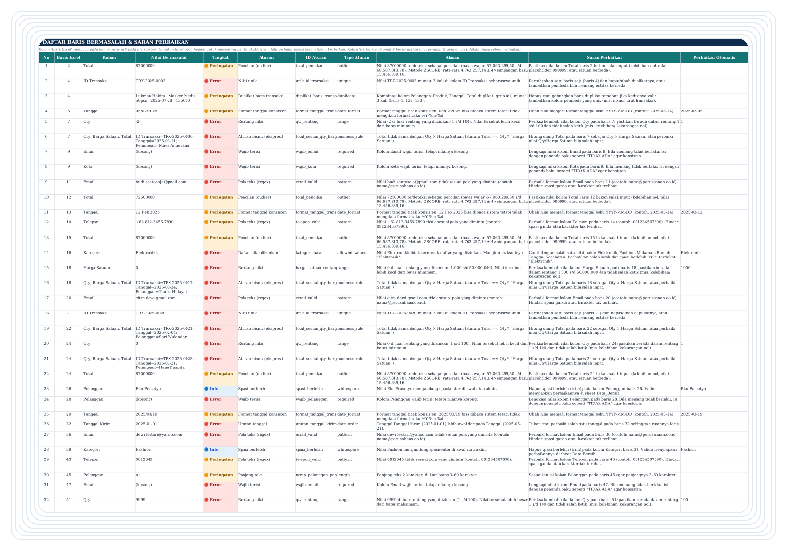<br>
<sub><b>2 · Temuan_Detail</b> — satu baris per temuan: nomor baris Excel, kolom, nilai bermasalah, tingkat, aturan, <b>alasan</b>, <b>saran perbaikan</b>, dan usulan perbaikan otomatis. Sudah dilengkapi filter &amp; warna per tingkat.</sub></td>
</tr>
<tr>
<td>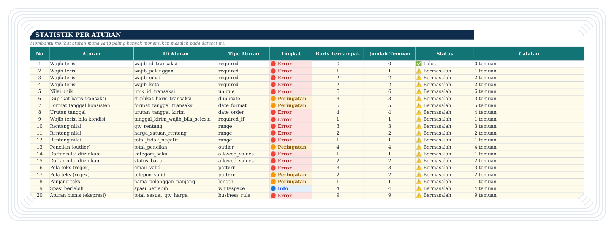<br>
<sub><b>3 · Statistik_Aturan</b> — baris terdampak, jumlah temuan, dan status setiap aturan (Lolos / Bermasalah / Dilewati / Gagal).</sub></td>
<td>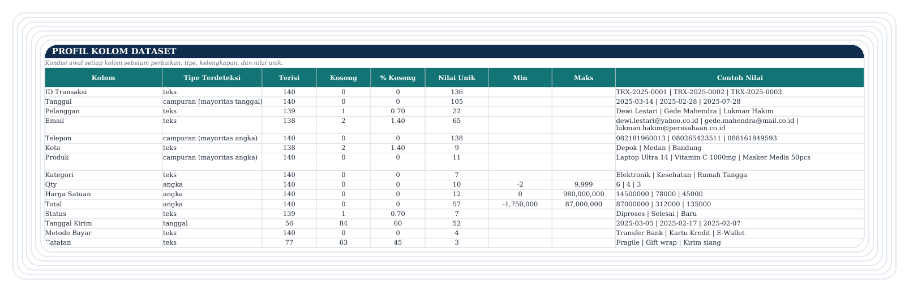<br>
<sub><b>4 · Profil_Kolom</b> — tipe terdeteksi, terisi/kosong, % kosong, nilai unik, min/maks, dan contoh nilai per kolom.</sub></td>
</tr>
<tr>
<td>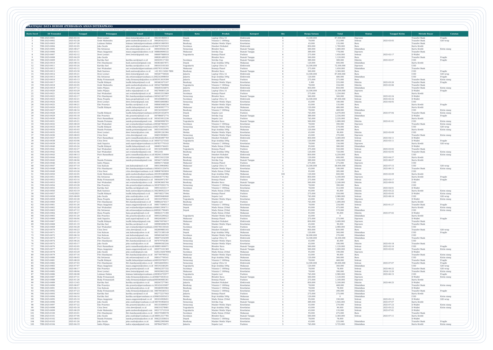<br>
<sub><b>5 · Data_Bersih</b> — pratinjau dataset setelah perbaikan otomatis yang aman diterapkan.</sub></td>
<td>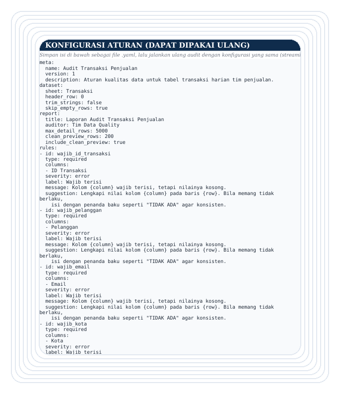<br>
<sub><b>6 · Konfigurasi</b> — YAML lengkap yang dipakai; salin, simpan, dan jalankan ulang audit yang sama kapan saja.</sub></td>
</tr>
</table>

Laporan contoh siap dibuka: **[`docs/contoh/laporan_valido.xlsx`](docs/contoh/laporan_valido.xlsx)**

Contoh isi kolom alasan &amp; saran pada sheet `Temuan_Detail`:

| Baris | Kolom | Nilai | Alasan | Saran Perbaikan | Perbaikan Otomatis |
| :---: | :--- | :--- | :--- | :--- | :--- |
| 5 | Tanggal | `05/02/2025` | Format tanggal tidak konsisten: `05/02/2025` bisa dibaca sistem tetapi tidak mengikuti format baku `%Y-%m-%d`. | Ubah nilai menjadi format tanggal baku `YYYY-MM-DD` (contoh: `2025-03-14`). | `2025-02-05` |
| 9 | Email | *(kosong)* | Kolom Email wajib terisi, tetapi nilainya kosong. | Lengkapi nilai kolom Email pada baris 9. Bila memang tidak berlaku, isi penanda baku seperti `"TIDAK ADA"`. | – |
| 7 | Qty, Harga Satuan, Total | `TRX-2025-0006` … | Total tidak sama dengan Qty × Harga Satuan (aturan: `Total == Qty * Harga Satuan`). | Hitung ulang Total pada baris 7 sebagai Qty × Harga Satuan, atau perbaiki Qty/Harga Satuan. | – |
| 82 | Status | `SELESAI` | Nilai `SELESAI` tidak termasuk daftar yang diizinkan. Mungkin maksudnya "Selesai". | Ganti dengan salah satu nilai baku: Baru, Diproses, Dikirim, Selesai, Dibatalkan. | `Selesai` |

---

## 🚀 Mulai cepat

**Prasyarat:** Python 3.10+ (dependensi: pandas, OpenPyXL, PyYAML, Streamlit).

```bash
git clone <repo-url> valido && cd valido
python -m venv .venv && source .venv/bin/activate       # Windows: .venv\Scripts\activate
pip install -r requirements.txt                          # atau: pip install -e ".[dev]"
```

**Jalankan aplikasi web:**

```bash
streamlit run app.py        # buka http://localhost:8501
```

Di sidebar aplikasi tersedia tombol **“Muat data contoh + aturan contoh”** — dataset 140 baris dengan 40+ masalah yang disengaja, supaya Anda bisa langsung melihat seluruh fitur tanpa menyiapkan file.

<p align="center">
  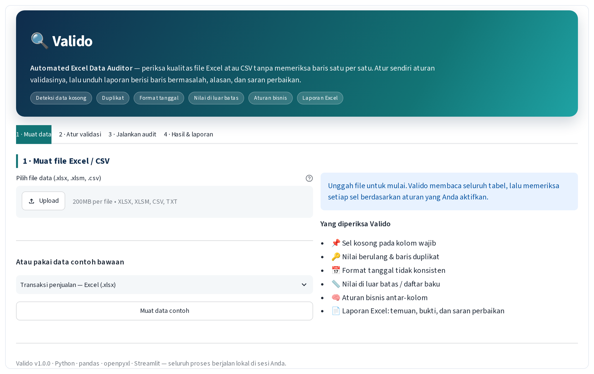
  <br>
  <sub><i>Tampilan pertama saat aplikasi dibuka: unggah file sendiri atau pakai data contoh, atur aturan, jalankan audit, lalu unduh laporan.</i></sub>
</p>

**Atau langsung lewat CLI:**

```bash
python cli.py audit examples/data/transaksi_penjualan.xlsx \
    --config configs/contoh_aturan_transaksi.yaml --out hasil --profile
```

> Ingin data contoh dibuat ulang? Jalankan `python scripts/make_sample_data.py`.

Tersedia juga `Makefile` untuk perintah sehari-hari: `make install`, `make run`, `make test`, `make lint`, `make demo`, `make clean`.

---

## 💻 Menggunakan CLI

```bash
# audit dengan konfigurasi yang sudah ada
python cli.py audit data.xlsx --config aturan.yaml --out hasil --profile

# buat draf aturan otomatis dari dataset
python cli.py init data_pelanggan.csv --out aturan_pelanggan.yaml

# audit tanpa konfigurasi (memakai aturan usulan otomatis)
python cli.py audit data.xlsx --out hasil

# informasi lain
python cli.py profile data.xlsx        # profil kolom
python cli.py sheets data.xlsx         # daftar sheet dalam file Excel
python cli.py rules                    # katalog 14 tipe aturan
```

Contoh keluaran:

```text
 __     __    _ _     _
 \ \   / /_ _| (_) __| | ___
  \ \ / / _` | | |/ _` |/ _ \   VALIDO
   \ V / (_| | | | (_| | (_) |  Automated Excel Data Auditor
    \_/ \__,_|_|_|\__,_|\___/

Dataset : transaksi_penjualan.xlsx [sheet: Transaksi]
Ukuran  : 140 baris × 15 kolom

────────────────────────────────────────────────────────────────────
 SKOR KESEHATAN DATA : 75.1/100  (grade B — Baik)
 Baris diperiksa     : 140  |  Bermasalah: 43
 Temuan              : 56  (🔴 37 error · 🟠 15 peringatan · 🔵 4 info)
 Aturan              : 20 dijalankan, 1 lolos, 19 bermasalah, 0 dilewati
────────────────────────────────────────────────────────────────────
 Masalah terbanyak:
   • Aturan bisnis (ekspresi): 9 temuan
   • Nilai unik: 6 temuan
   • Rentang nilai: 6 temuan
   • Format tanggal konsisten: 5 temuan
   • Pola teks (regex): 5 temuan

 Laporan Excel : hasil/laporan_valido.xlsx
 Temuan CSV    : hasil/temuan_valido.csv
```

Kode keluar: `0` sukses · `2` file/konfigurasi tidak valid — sehingga pipeline bisa digagalkan otomatis saat audit tidak dapat dijalankan.

---

## 🧩 14 tipe aturan

| Ikon | Tipe | Fungsi | Parameter penting |
| :---: | :--- | :--- | :--- |
| 📌 | `required` | Sel wajib terisi (kosong/spasi/`N/A` terdeteksi) | – |
| 🔀 | `required_if` | Wajib terisi **bila kondisi** terpenuhi | `when` (ekspresi) |
| 🔑 | `unique` | Nilai tidak boleh berulang | `ignore_case`, `ignore_whitespace` |
| 👯 | `duplicate` | Baris ganda berdasarkan kolom kunci | `columns` (kosong = semua kolom) |
| 📅 | `date_format` | Format tanggal konsisten & valid | `formats`, `strict` |
| ⏱️ | `date_order` | Urutan dua tanggal logis | – (butuh 2 kolom) |
| 📏 | `range` | Nilai numerik dalam batas | `min`, `max`, `allow_blank`, `allow_non_numeric` |
| 🔢 | `dtype` | Tipe data seragam | `expected`: number / integer / date / boolean / text |
| 📈 | `outlier` | Nilai statistik ekstrem | `method` (iqr/zscore), `factor`, `threshold` |
| ✅ | `allowed_values` | Hanya nilai baku | `values`, `case_sensitive`, `allow_blank` |
| 🔤 | `pattern` | Pola teks (regex) | `regex`, `full_match`, `hint` |
| ✂️ | `length` | Panjang teks | `min`, `max` |
| 🧹 | `whitespace` | Spasi/enter berlebih | – (bisa banyak kolom) |
| 🧠 | `business_rule` | Ekspresi antar-kolom | `expression` |

Setiap aturan menerima `severity` (`error` / `warning` / `info`), `id`, `label`, serta `message` dan `suggestion` yang dapat dijinakkan sendiri dengan placeholder seperti `{column}`, `{row}`, `{value}`, `{bounds}`.

📖 Referensi rinci + contoh YAML untuk setiap tipe: **[docs/ATURAN.md](docs/ATURAN.md)**

---

## ⚙️ Contoh konfigurasi

```yaml
meta:
  name: Audit Transaksi Penjualan
dataset:
  sheet: Transaksi
  header_row: 0
report:
  title: Laporan Audit Transaksi Penjualan
  auditor: Tim Data Quality

rules:
  - id: unik_id_transaksi
    type: unique
    columns: [ID Transaksi]
    severity: error

  - id: format_tanggal
    type: date_format
    columns: [Tanggal]
    formats: ["%Y-%m-%d"]          # [] = deteksi format dominan otomatis
    severity: warning

  - id: total_pencilan
    type: outlier
    columns: [Total]
    severity: warning
    method: zscore
    threshold: 4.0

  - id: total_sesuai_qty_harga
    type: business_rule
    columns: [Qty, Harga Satuan, Total]
    expression: "Total == Qty * `Harga Satuan`"
    severity: error

  - id: tanggal_kirim_wajib
    type: required_if
    columns: [Tanggal Kirim]
    when: "Status.isin(['Dikirim', 'Selesai'])"
    severity: error
```

> Nama kolom yang mengandung spasi ditulis di antara backtick: `` `Harga Satuan` ``.
> Konfigurasi lengkap 20 aturan untuk dataset contoh: [`configs/contoh_aturan_transaksi.yaml`](configs/contoh_aturan_transaksi.yaml)

---

## 🏅 Skor kesehatan data

Skor **0–100** dihitung dari proporsi baris bermasalah, dibobot tingkat keparahan dan jumlah pelanggaran per baris — sehingga dataset besar dengan sedikit masalah tetap dinilai secara proporsional:

```text
penalti = Σ (bobot_baris + 0.06 × (jumlah_temuan_baris − 1)) / jumlah_baris
skor    = 100 × (1 − min(1, penalti))
```

| Bobot | `error` | `warning` | `info` |
| :--- | :---: | :---: | :---: |
| Per baris | 1.00 | 0.40 | 0.12 |

| Grade | Rentang | Arti |
| :---: | :--- | :--- |
| **A** | ≥ 90 | Sangat baik — data siap dipakai |
| **B** | 75–89 | Baik — perlu perbaikan kecil |
| **C** | 60–74 | Cukup — bersihkan sebelum dipakai untuk pelaporan |
| **D** | 40–59 | Buruk — prioritaskan perbaikan |
| **E** | < 40 | Kritis — audit ulang setelah perbaikan |

Baris tanpa temuan tidak menurunkan skor; aturan yang dilewati (mis. kolom tidak ada) juga tidak dihitung.

---

## 🐍 Pemakaian sebagai library

Paket `valido` tidak bergantung pada Streamlit, sehingga bisa dipakai di script, notebook, atau pipeline ETL:

```python
from valido import load_dataset_info, load_config, run_audit, build_report

loaded = load_dataset_info("transaksi.xlsx", sheet="Transaksi")
config = load_config("configs/contoh_aturan_transaksi.yaml")

result = run_audit(loaded.df, config, first_data_row_excel=2)

print(result.score, result.grade)      # 75.1  B
print(result.counts)                  # {'error': 37, 'warning': 15, 'info': 4}
print(result.findings.head())         # DataFrame temuan (alasan + saran)
print(result.rule_stats)              # statistik per aturan
print(result.fixed_df.head())         # data setelah perbaikan otomatis

build_report(result, "laporan_valido.xlsx", notes=loaded.notes)
```

Fungsi lain yang tersedia: `suggest_rules(df)`, `normalize_config(dict)`, `save_config()`,
`profile_columns(df)`, `export_findings_csv()`, dan `export_clean_csv()`.

---

## 🗂️ Struktur proyek

```text
valido/
├── app.py                          # Aplikasi Streamlit (4 langkah)
├── cli.py                          # Titik masuk CLI
├── configs/
│   └── contoh_aturan_transaksi.yaml    # 20 aturan siap pakai
├── examples/data/
│   ├── transaksi_penjualan.xlsx        # dataset contoh (40+ masalah disengaja)
│   └── transaksi_penjualan.csv
├── valido/                         # paket inti (tanpa dependensi Streamlit)
│   ├── config.py                   # katalog 14 tipe aturan, validasi konfigurasi
│   ├── rules.py                    # implementasi setiap tipe aturan
│   ├── engine.py                   # orkestrasi audit, skor, auto-fix
│   ├── expr.py                     # evaluator ekspresi aman (tanpa builtins)
│   ├── loader.py                   # pembacaan Excel/CSV
│   ├── profile.py                  # profiling kolom + saran aturan
│   ├── report.py                   # laporan Excel (OpenPyXL) & ekspor CSV
│   └── cli.py                      # perintah audit/init/profile/sheets/rules
├── scripts/
│   ├── make_sample_data.py         # pembuat dataset contoh
│   ├── capture_screenshots.py      # ambil tangkapan layar UI (Playwright)
│   ├── render_report_preview.py    # render sheet laporan → PNG
│   └── process_screenshots.py      # potong sidebar, sudut membulat, optimasi
├── tests/                          # 174 test pytest
├── docs/
│   ├── ATURAN.md                   # referensi semua tipe aturan
│   ├── logo.svg
│   └── screenshots/
├── .github/workflows/ci.yml        # lint + test + smoke test CLI
├── requirements.txt · pyproject.toml · Makefile · LICENSE
```

---

## ✅ Pengujian

```bash
python -m pytest                              # 174 test
python -m pytest --cov=valido --cov-report=term-missing
ruff check .                                  # lint
```

| Berkas | Fokus | Kasus |
| :--- | :--- | :---: |
| `test_utils.py` | parsing angka/tanggal (format Indonesia & internasional), deteksi nilai kosong | 45 |
| `test_rules.py` | setiap tipe aturan: deteksi, pesan, nomor baris Excel | 35 |
| `test_config.py` | validasi konfigurasi, normalisasi, YAML/JSON, saran aturan | 23 |
| `test_engine.py` | agregasi temuan, skor, statistik, perbaikan otomatis | 16 |
| `test_loader.py` | encoding, delimiter, header, kolom duplikat/tanpa nama | 19 |
| `test_report.py` | struktur 6 sheet, isi ringkasan, ekspor CSV | 10 |
| `test_cli.py` | perintah CLI dan kode keluar | 10 |
| `test_expr.py` | ekspresi aman, backtick kolom, penolakan kode berbahaya | 11 |
| `test_app.py` | smoke test UI Streamlit (AppTest): muat data → audit → unduhan | 5 |

CI (`.github/workflows/ci.yml`) menjalankan lint, seluruh test, dan smoke test CLI pada Python 3.10, 3.11, dan 3.12.

<details>
<summary><b>Memperbarui tangkapan layar di README</b></summary>

Semua gambar di `docs/screenshots/` dihasilkan otomatis — tidak ada mockup manual:

```bash
pip install playwright pymupdf          # sekali saja
playwright install chromium

# 1. tangkapan layar aplikasi (butuh aplikasi berjalan di :8501)
streamlit run app.py --server.port 8501 &
python scripts/capture_screenshots.py     # tangkap layar UI
python scripts/process_screenshots.py     # potong sidebar, sudut membulat, optimasi

# 2. pratinjau sheet laporan (butuh LibreOffice untuk konversi PDF)
python scripts/render_report_preview.py
```
</details>

---

## 🧭 Desain & batasan

- **Tipe asli dipertahankan.** Angka atau tanggal yang tersimpan sebagai teks tidak dikonversi diam-diam — justru itu temuan yang dilaporkan (`dtype`, `date_format`).
- **Perbaikan otomatis bersifat usulan.** Hanya kasus tidak ambigu yang diisi (trim, normalisasi tanggal, koreksi ke nilai baku terdekat, pembatasan ke rentang). Duplikat, sel wajib yang kosong, dan pelanggaran aturan bisnis tetap harus diputuskan manusia.
- **Ekspresi dievaluasi tanpa `builtins`.** Hanya nama kolom, operator perbandingan, `isin`, dan fungsi matematika dasar; atribut privat dan fungsi berbahaya ditolak saat konfigurasi dibaca.
- **Ambang deteksi perlu disesuaikan.** Aturan seperti `outlier` dan `length` sebaiknya di-tuning per dataset; Valido memberi peringatan (bukan error) agar tidak memblokir proses.
- **Batas ukuran.** Dirancang untuk file operasional (ratusan ribu baris). Untuk data jauh lebih besar, jalankan `run_audit` per potongan data.
- **Privasi.** Semua proses berjalan lokal di sesi pengguna; tidak ada data yang dikirim ke layanan luar.

---

## ❓ FAQ

<details>
<summary><b>Apakah file saya diunggah ke server?</b></summary>

Tidak. Aplikasi Streamlit memproses file di memori sesi; tidak ada panggilan jaringan keluar untuk data.
</details>

<details>
<summary><b>Format file apa saja yang didukung?</b></summary>

Excel (`.xlsx`, `.xlsm`) dan teks berdelimiter (`.csv`, `.txt`, `.tsv`) dengan deteksi encoding (UTF-8, Latin-1, CP1252) dan pemisah kolom (`,` `;` tab `|`) otomatis. File `.xls` lama sebaiknya disimpan ulang sebagai `.xlsx`.
</details>

<details>
<summary><b>Bagaimana kalau file punya judul di beberapa baris atas?</b></summary>

Ubah **baris header** di tab *Muat data* (mis. `2` bila header ada di baris ketiga file), atau set `dataset.header_row` pada YAML.
</details>

<details>
<summary><b>Apakah aturan bisa dipakai ulang di dataset bulan berikutnya?</b></summary>

Bisa. Unduh konfigurasi (YAML) atau ambil dari sheet `Konfigurasi`, lalu jalankan `python cli.py audit data_baru.xlsx --config aturan.yaml`.
</details>

<details>
<summary><b>Bagaimana menambah tipe aturan baru?</b></summary>

Tambahkan entri pada katalog `RULE_TYPES` di `valido/config.py`, implementasikan fungsinya di `valido/rules.py`, lalu daftarkan pada `RULES`. UI Streamlit akan menampilkan form parameter secara otomatis.
</details>

<details>
<summary><b>Kenapa sebagian aturan berstatus “Dilewati”?</b></summary>

Aturannya merujuk kolom yang tidak ada pada file (mis. nama kolom berubah). Audit tetap berjalan; detailnya tercatat di sheet `Statistik_Aturan` dan bagian catatan laporan.
</details>

---

## 🗺️ Roadmap

- [x] 14 tipe aturan + konfigurasi YAML
- [x] Laporan Excel 6 sheet dengan saran perbaikan
- [x] Skor kesehatan data & grade
- [x] Perbaikan otomatis yang aman
- [x] CLI dengan exit code untuk otomasi
- [x] 174 test + CI multi-versi Python
- [ ] Aturan lintas-file (validasi terhadap tabel referensi / master data)
- [ ] Ekspor laporan PDF sekali klik
- [ ] Penjadwalan audit berkala + notifikasi (Slack/email)
- [ ] Dukungan `.xls` dan file terenkripsi password

---

## 📄 Lisensi

Dirilis di bawah **[MIT License](LICENSE)** — bebas dipakai dan dimodifikasi, termasuk untuk kebutuhan internal perusahaan.

<p align="center">
  <sub>Dibangun dengan <b>Python</b> · <b>pandas</b> · <b>OpenPyXL</b> · <b>Streamlit</b> · <b>pytest</b></sub><br>
  <sub>Valido v1.0.0 — Automated Excel Data Auditor</sub>
</p>
